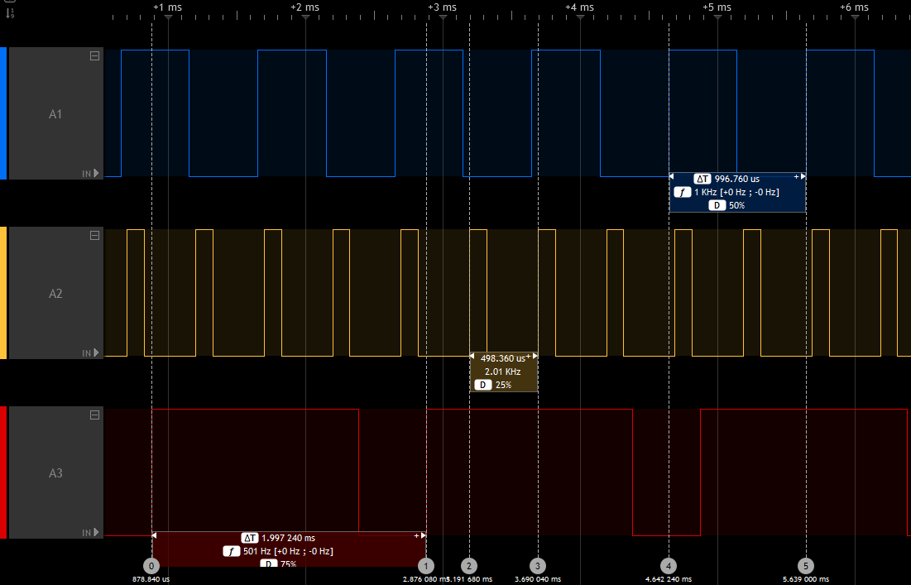

# API

> [!NOTE]
> Since core release **3.0.0**, the STM32 Arduino core is based on the official [ArduinoCore-API](https://github.com/arduino/ArduinoCore-API). It provides the standard Arduino API contracts, types, and interfaces used by the core, while STM32-specific extensions remain available. See the [STM32 ArduinoCore-API integration](https://github.com/stm32duino/ArduinoCore-API) for implementation details.

This page documents STM32-specific additions and extensions. For the standard Arduino API, see the [Arduino language reference](https://docs.arduino.cc/language-reference/) and the [ArduinoCore-API documentation](https://github.com/arduino/ArduinoCore-API).

## Core

This part describes the STM32 core functions.

### Core version
The core version API was introduced in version **1.5.0** and follows [Semantic Versioning 2.0.0](https://semver.org/).

The version is defined in [`stm32_def.h`](https://github.com/stm32duino/Arduino_Core_STM32/blob/main/cores/arduino/stm32/stm32_def.h).

`STM32_CORE_VERSION` defines the core version with:

- `STM32_CORE_VERSION_MAJOR`: major version [31:24]
- `STM32_CORE_VERSION_MINOR`: minor version [23:16]
- `STM32_CORE_VERSION_PATCH`: patch version [15:8]
- `STM32_CORE_VERSION_EXTRA`: Extra label [7:0], with:
    - `0`: official release
    - `[1-9]`: release candidate
    - `F[0-9]`: development

#### Example

```C
#if !defined(STM32_CORE_VERSION) || (STM32_CORE_VERSION  <= 0x01050000)
/* Do something for core version lesser than or equal to 1.5.0 */
#else
/* Do something for core version greater than 1.5.0 */
#endif
```

### Core Callback

CoreCallback functions allows to register a callback function called in the loop of the `main()` function.
If you need to call as often as possible a function to update your system and you want to be sure this function to be called, you can add it to the callback list. Otherwise, your function should be called inside the `loop()` function of
the sketch.

* `void registerCoreCallback(void (*func)(void))`: register a callback function
_Params_ `func` pointer to the callback function

* `void unregisterCoreCallback(void (*func)(void))`: unregister a callback function
_Params_ `func` pointer to the callback function

> [!WARNING]
> By default, the core callback feature is disabled, to enable it `CORE_CALLBACK` must be defined.

[`build_opt.h`][build_opt.h] can be used to define it by adding `-DCORE_CALLBACK`.

## STM32 extensions

### Analog

#### analogWrite: DAC, PWM or GPIO

`analogWrite()` function follows the [API reference](https://www.arduino.cc/reference/en/language/functions/analog-io/analogwrite/).
As each pin has not the same capabilities, it uses the best way:

1. True analog output when using pins with DAC capabilities if `HAL_DAC_MODULE_ENABLED` is defined
2. PWM on pins with timer (TIM) capabilities.
3. GPIO toggling HIGH/LOW depending on requested value: `HIGH` if > 127 else `LOW`

#### Frequency
`analogWriteFrequency(freq)` has been added in core version greater than **1.5.0** to set the frequency used by `analogWrite()`. Default is `PWM_FREQUENCY` (1000) in Hertz.

> [!NOTE]
> frequency is common to all channels of a specified timer, setting the frequency for one channel will impact all others of the same timer.

##### Example
```C
  // Assuming Ax pins have PWM capabilities and use a different Timer.
  analogWrite(A1, 127); // Start PWM on A1, at 1000 Hz with 50% duty cycle
  analogWriteFrequency(2000); // Set PWM period to 2000 Hz instead of 1000
  analogWrite(A2, 64); // Start PWM on A2, at 2000 Hz with 25% duty cycle
  analogWriteFrequency(500); // Set PWM period to 500 Hz
  analogWrite(A3, 192); // Start PWM on A3, at 500 Hz with 75% duty cycle
```



#### DAC output buffer

> [!NOTE]
> Available since version 2.8.0, thanks to [PR #2309](https://github.com/stm32duino/Arduino_Core_STM32/pull/2309).

It is now possible to disable the DAC output buffer (which is enabled by default) by defining `DISABLE_DAC_OUTPUTBUFFER`
using one of the below options:

- [hal_conf_extra.h](customization/HAL-configuration.md)
- [`build_opt.h`][build_opt.h]
- header file of the variant: `variant_<boardname>.h`

#### ADC general
 * setup: `pinMode(pin, INPUT_ANALOG);`
   has to be an ADC pin (e.g. PA0)
 * read: `uint16_t adc_value = analogRead(pin);`

#### ADC internal channels
Available in core version greater than **1.5.0**

`analogRead()` can now be used to read some  internal channels with the following definitions:

- `ATEMP`: internal temperature sensor
- `AVREF`: VrefInt, internal voltage reference
- `AVBAT`: Vbat voltage

#### ADC read resolution (bits)

By default, `analogRead(pin)` returns 10-bit values to match the classic Arduino behavior and library expectations.

Use `analogReadResolution(int bits)` to select another resolution, for example `analogReadResolution(12)` for a 12-bit ADC.

#### ADC sampling time

A minimum ADC sampling time is required when reading internal channels, so the default is set to the maximum available value. It can be defined more precisely with:

- `ADC_SAMPLINGTIME_INTERNAL`: set this to the desired ADC sample time.

`ADC_SAMPLINGTIME` and `ADC_CLOCK_DIV` could also be redefined by the variant or using [`build_opt.h`][build_opt.h].

##### Example
An example that reads and converts the three internal channels and A0 is provided by the [STM32Examples](https://github.com/stm32duino/STM32Examples) library:
[Internal_channels](https://github.com/stm32duino/STM32Examples/blob/main/examples/Peripherals/ADC/Internal_channels/Internal_channels.ino)

> [!WARNING]
> This example is provided as-is and may require updates for device-specific datasheet values.

### HardwareSerial

STM32 MCUs have several _U(S)ART_ peripherals. For convenience, the _U(S)ART_**x** number is used to define the `Serialx` instance:

- `Serial1` for `USART1`
- `Serial2` for `USART2`
- `Serial3` for `USART3`
- `Serial4` for `UART4`
- ...

For _LPUART_ peripherals:

- `SerialLP1` for `LPUART1`
- `SerialLP2` for `LPUART2`
- `SerialLP3` for `LPUART3`

**By default, only one `Serialx` instance is available mapped to the generic `Serial` name.**

To use a second serial port, a `HardwareSerial` object should be declared in the sketch before the `setup()` function:
```C++
//                      RX    TX
HardwareSerial Serial1(PA10, PA9);

void setup() {
  Serial1.begin(115200);
}

void loop() {
  Serial1.println("Hello World!");
  delay(1000);
}
```

Another solution is to add a [`build_opt.h`][build_opt.h] file alongside your main `.ino` file with: `-DENABLE_HWSERIALx`.

This will define the `Serialx` instance using the first `USARTx` instance found in the `PeripheralPins.c` of your variant.

> [!NOTE]
> that only the latter solution allows to use the `serialEventx()` callback in the sketch.

For Example, if you define in the [`build_opt.h`][build_opt.h]: `-DENABLE_HWSERIAL3`

This will instantiate `Serial3` with the first Rx and Tx pins found in the `PinMap_UART_RX[]` and `PinMap_UART_TX[]` arrays in the `PeripheralPins.c` of your variant and the `serialEvent3()` will be enabled.

To specify which Rx or Tx pins should be used instead of the first one found, define `PIN_SERIALn_RX` or `PIN_SERIALn_TX`, where **n** is the number of the Serial instance.

Example for the `Serial3`:

- In the `variant.h`:

```c
#define PIN_SERIAL3_RX PB11
#define PIN_SERIAL3_TX PB10
```

- In the [`build_opt.h`][build_opt.h], use:

`-DPIN_SERIAL3_RX=PB11 -DPIN_SERIAL3_TX=PB10`

#### New API functions

##### Change default `Serial` instance pins
It is also possible to change the default pins used by the `Serial` instance using above API:

* `void setRx(uint32_t rx)`
* `void setTx(uint32_t tx)`
* `void setRx(PinName rx)`
* `void setTx(PinName tx)`

> [!WARNING]
> Have to be called before `begin()`.

###### Example:
```C++
    Serial.setRx(PG_9); // using pin name PY_n
    Serial.setTx(PG14); // using pin number PYn
    Serial.begin(9600);
```

##### Enable half-duplex mode

Available in core version greater than **1.7.0**

It is now possible to set a `HardwareSerial` in half-duplex mode.

The `U(S)ART` can be configured to follow a single-wire half-duplex protocol where the Tx and Rx lines are internally connected. In this communication mode, only the Tx pin is used for both transmission and reception.

* Extended `HardwareSerial` constructors:
  * `HardwareSerial(uint32_t _rxtx)`: U(S)ART Tx pin number (`PYn`) used for half-duplex
  * `HardwareSerial(PinName _rxtx)`: U(S)ART Tx pin name (`PY_n`) used for half-duplex
  * if `Rx == Tx` then assume half-duplex mode:
    * `HardwareSerial(uint32_t _rx, uint32_t _tx)`: U(S)ART Tx pin number (`PYn`) used for half-duplex
    * `HardwareSerial(PinName _rx, PinName tx)`: U(S)ART Tx pin name (`PY_n`) used for half-duplex
  * `HardwareSerial(void *peripheral, HalfDuplexMode_t halfDuplex = HALF_DUPLEX_DISABLED)`: if `HALF_DUPLEX_ENABLED` get the first Tx pin for requested peripheral in the` PeripheralPins.c` used for half-duplex

* Add `enableHalfDuplexRx()` to enable Serial in Rx mode. Doing a `read()` could be used but will avoid to perform a read. Useful before `available()` usage
* `void setHalfDuplex()`: enable half-duplex mode of an instance when it not instantiate in half-duplex mode. Must be call before `begin()` in this case.

###### Example for a **Nucleo L496ZG-P**:
`Serial4` sends byte to `Serial3`, compare values then `Serial3` resend it to `Serial4` and compare.
Require to connect `PA0` and` PB10`.

_All possible constructor are listed._

```C++
HardwareSerial Serial3(PA0);
HardwareSerial Serial4(PB10);

//HardwareSerial Serial3(PA_0);
//HardwareSerial Serial4(PB_10);

//HardwareSerial Serial3(UART4, HALF_DUPLEX_ENABLED);
//HardwareSerial Serial4(USART3, HALF_DUPLEX_ENABLED);

//HardwareSerial Serial3(PA0, PA0);
//HardwareSerial Serial4(PB10, PB10);

//HardwareSerial Serial3(PA_0, PA_0);
//HardwareSerial Serial4(PB_10, PB_10);

//HardwareSerial Serial3(NC, PA_0);
//HardwareSerial Serial4(NC, PB_10);

//HardwareSerial Serial3(NUM_DIGITAL_PINS, PA0);
//HardwareSerial Serial4(NUM_DIGITAL_PINS, PB10);

static uint32_t nbTestOK = 0;
static uint32_t nbTestKO = 0;
void test_uart(int val)
{
  int recval = -1;
  uint32_t error = 0;

  Serial4.write(val);
  delay(10);
  while (Serial3.available()) {
    recval = Serial3.read();
  }
  /* Enable Serial4 to RX*/
  Serial4.enableHalfDuplexRx();
  if (val == recval) {
    Serial3.write(val);
    delay(10);

    while (Serial4.available()) {
      recval = Serial4.read();
    }
    /* Enable Serial3 to RX*/
    Serial3.enableHalfDuplexRx();
    if (val == recval) {
      nbTestOK++;
      Serial.print("Exchange: 0x");
      Serial.println(recval, HEX);
    } else {
      error = 2;
    }
  }
  else {
    error = 1;
  }
  if (error) {
    Serial.print("Send: 0x");
    Serial.print(val, HEX);
    Serial.print("\tReceived: 0x");
    Serial.print(recval, HEX);
    Serial.print(" --> KO <--");
    Serial.println(error);
    nbTestKO++;
  }
}

void setup() {
  Serial.begin(115200);
  Serial4.begin(9600);
  Serial3.begin(9600);
}

void loop() {

  for (uint32_t i = 0; i <= (0xFF); i++) {
    test_uart(i);
  }

  Serial.println("Serial Half-Duplex test done.\nResults:");
  Serial.print("OK: ");
  Serial.println(nbTestOK);
  Serial.print("KO: ");
  Serial.println(nbTestKO);
  while (1);
}
```

> [!NOTE]
> Serial Rx/TX buffer size can be changed, see [Custom-definitions#serial-rxtx-buffer-size](customization/Custom-definitions.md)

##### Enable hardware flow control

Available in core version **2.3.0** or later

* `HardwareSerial` constructors accept optional RTS/CTS pins:
  * `HardwareSerial(uint32_t _rx, uint32_t _tx, uint32_t _rts = NUM_DIGITAL_PINS, uint32_t _cts = NUM_DIGITAL_PINS)`
  * `HardwareSerial(PinName _rx, PinName _tx, PinName _rts = NC, PinName _cts = NC)`
* You can also enable RTS/CTS pins on `HardwareSerial` instances:
  * `void setRts(uint32_t _rts)`
  * `void setCts(uint32_t _cts)`
  * `void setRtsCts(uint32_t _rts, uint32_t _cts)`
  * `void setRts(PinName _rts)`
  * `void setCts(PinName _cts)`
  * `void setRtsCts(PinName _rts, PinName _cts)`

###### Example:

```C++
// Enable hardware flow control on construction.
HardwareSerial serial(PA10, PA9, PA12, PA11);

// Or, enable later (but before calling begin()).
HardwareSerial serial(PA10, PA9);
serial.setRtsCts(PA12, PA11);
serial.begin(460800);
```

##### Enable Tx, Rx Pin Active Level and/or Data Inversion

Available in core version greater than **2.10.1**

The U(S)ART Tx and Rx pin signal values can be inverted (VDD = 0/mark, Gnd = 1/idle), and the U(S)ART can send and receive data in negative/inverse logic (1 = L, 0 = H); the
parity bit is also inverted.

* Enable Tx and Rx active level inversion on `HardwareSerial` instances, respectively:
  * `void setTxInvert(void)`
  * `void setRxInvert(void)`
* Enable data inversion on `HardwareSerial` instances:
  * `void setDataInvert(void)`

### HardwareTimer library

See the [HardwareTimer library reference](HardwareTimer-library.md) for the timer API and STM32-specific timer features.


## Other

### Remembering variables across resets
Since core version 1.9.0 (see [PR #996](https://github.com/stm32duino/Arduino_Core_STM32/pull/996)), it is possible to mark variables as "noinit", which prevents them from being initialized to a fixed value at startup. This allows using these variables to remember a value across resets (since the reset itself leaves memory unchanged, it is only the startup code that normally resets all variable values, but that is prevented by noinit).

To do this, the variable must be placed in the `.noinit` section by adding `__attribute__((__section__(".noinit")))` (this is exactly the same as how this works on the original Arduino AVR core). Typically, you would also need to check the startup reason register so you can initialize the variable with a default on the first startup. For example, something like:

```C++
unsigned boot_count __attribute__((__section__(".noinit")));

void setup() {
    Serial.begin(115200);
    while (!Serial); // Wait for serial port open

    // Initialize the variable only on first power-on reset
    if (__HAL_RCC_GET_FLAG(RCC_FLAG_BORRST))
        boot_count = 1;
    __HAL_RCC_CLEAR_RESET_FLAGS();

    Serial.print("Boot number: ");
    Serial.println(boot_count);
    ++boot_count;
}

void loop() { }
```

This shows the number of boots since the last POR by incrementing a noinit variable across resets. Note that when you first upload this, it might not start at 1 but at some arbitrary value, because typically the first boot after an upload is not a power-on-reset. To start at 1, disconnect and reconnect power.

[build_opt.h]: customization/Customize-build-options-using-build_opt.h.md
[PR #853]: https://github.com/stm32duino/Arduino_Core_STM32/pull/853
